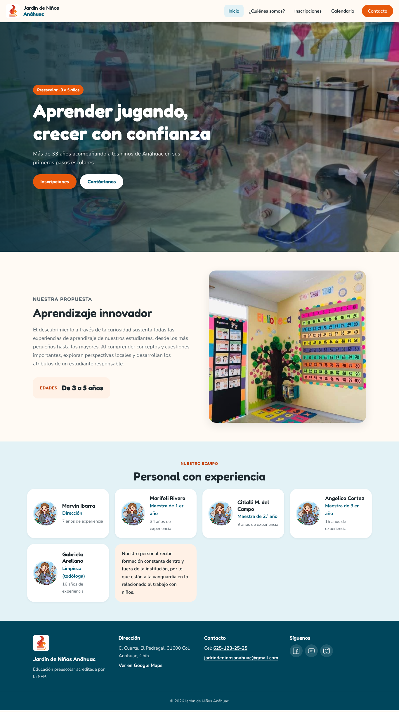
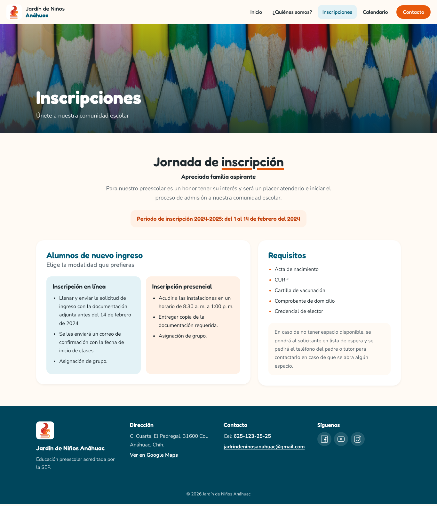
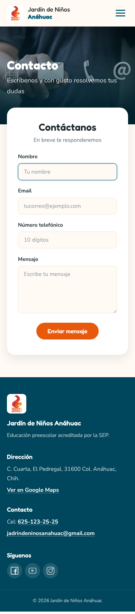

<h1 align="center">Jardín de Niños Anáhuac</h1>

<div align="center"></div>

<p align="center">
  <a href="https://arcan16.github.io/jardin/"></a>
  
  
</p>

## Descripción

Sitio web informativo del Jardín de Niños Anáhuac, un preescolar para niños de 3 a 5 años en la colonia Anáhuac, Chihuahua. Presenta la escuela a las familias interesadas: su propuesta educativa, el personal, el proceso de inscripción, el calendario escolar y un formulario de contacto.

**Sitio publicado:** https://arcan16.github.io/jardin/

<p align="center">
  
</p>

## Páginas

| Página | Ruta | Contenido |
|---|---|---|
| Inicio | `/` | Portada con fotos de la escuela, propuesta educativa, edades y personal |
| ¿Quiénes somos? | `/nosotros` | Historia de la escuela, misión, visión y valores |
| Inscripciones | `/inscripciones` | Periodo de inscripción, modalidades en línea y presencial, y requisitos |
| Calendario | `/calendario` | Calendario escolar de Google Calendar integrado |
| Contacto | `/contacto` | Formulario de contacto (enviado con [FormSubmit](https://formsubmit.co/)) |

Todas las páginas incluyen el pie con la dirección, el teléfono, el correo y las redes sociales.

<table>
  <tr>
    <td></td>
    <td align="center"></td>
  </tr>
</table>

## Tecnologías utilizadas

- **React 18** con **Vite 4**
- **React Router 6** para la navegación entre páginas
- **CSS** propio con variables de diseño, sin frameworks de estilos
- Tipografías **Fredoka** y **Nunito** de Google Fonts
- **GitHub Actions** y **GitHub Pages** para la publicación

## Diseño

- Colores del logo: azul institucional (`#005b77`) y naranja (`#e8590c`) sobre fondo crema.
- Diseño adaptable: en el móvil la navegación se convierte en un menú desplegable y el contenido pasa a una columna.
- Todos los estilos están en `src/App.css`. Los colores, radios y sombras se definen como variables al inicio del archivo (`:root`), así que para cambiar la paleta basta con editar esos valores.

## Requisitos

- [Node.js](https://nodejs.org/) 18 o superior (incluye npm)

## Cómo ejecutar el proyecto en desarrollo

1. Clona el repositorio e instala las dependencias:
   ```bash
   git clone https://github.com/arcan16/jardin.git
   cd jardin
   npm install
   ```
2. Arranca el servidor de desarrollo:
   ```bash
   npm run dev
   ```
3. Abre la dirección que muestra la terminal, que termina en `/jardin/` (por ejemplo http://localhost:5173/jardin/). El sitio usa esa ruta base porque se publica en `arcan16.github.io/jardin/`.

### Otros comandos

| Comando | Descripción |
|---|---|
| `npm run build` | Genera la versión de producción en `dist/` y copia `index.html` como `404.html` para que las rutas internas funcionen en GitHub Pages |
| `npm run preview` | Sirve localmente la versión de producción |
| `npm run lint` | Revisa el código con ESLint |

## Publicación

Cada cambio que se sube a la rama `main` se publica automáticamente en GitHub Pages con el workflow `.github/workflows/jekyll-gh-pages.yml`, que instala las dependencias, compila el sitio y despliega la carpeta `dist/`. El progreso se puede seguir en la pestaña **Actions** del repositorio.

Si cambias la dirección en la que se publica el sitio, actualiza la ruta `/jardin/` en dos lugares: `base` en `vite.config.js` y `basename` en `src/App.jsx`.

## Cómo editar el contenido

| Qué cambiar | Dónde |
|---|---|
| Textos de cada página | `src/pages/` |
| Personal (nombre, puesto y experiencia) | Lista `personal` al inicio de `src/pages/Home.jsx` |
| Portada de la página de inicio | `src/Components/Carrusel.jsx` |
| Dirección, teléfono, correo y redes sociales | `src/Components/Pie.jsx` |
| Destino del formulario de contacto | Atributo `action` del formulario en `src/Components/Formulario.jsx` |
| Calendario escolar | Dirección del `iframe` en `src/Components/CalendarioGoogle.jsx` |
| Fotos | `public/` (las de la portada y los encabezados se indican en `src/App.css`) |

## Estructura del proyecto

```
├── public/              # Imágenes, logo e íconos de redes sociales
├── src/
│   ├── App.jsx          # Rutas del sitio
│   ├── App.css          # Estilos y variables de diseño
│   ├── Components/      # Barra de navegación, encabezado, carrusel, formulario, calendario y pie
│   └── pages/           # Inicio, Quiénes somos, Inscripciones, Calendario y Contacto
├── docs/capturas/       # Capturas de pantalla para este README
└── vite.config.js       # Configuración de Vite (ruta base /jardin/)
```

## Pendientes

- Sustituir la foto del encabezado de "¿Quiénes somos?" y la ilustración del personal, que tienen marcas de agua de bancos de imágenes, por fotos propias o con licencia.
- Actualizar el periodo de inscripción, que todavía corresponde al ciclo 2024-2025.
- Añadir las direcciones de Facebook, YouTube e Instagram en `src/Components/Pie.jsx`, que ahora apuntan a `#`.

---

<p align="center">
  Desarrollado por <a href="https://github.com/arcan16">arcan16</a> ·
  <a href="https://www.linkedin.com/in/sergioparedesarellano">LinkedIn</a>
</p>
